# Playverse


**Play it live:** https://playverse-app.onrender.com · also available as an installable Android app

Playverse is a game hub with four realistic 3D games, user accounts, leaderboards, player profiles and real-time online multiplayer. It runs in any modern browser, installs on phones as an app, and is built end to end: UI/UX design, 3D game engines, REST API, WebSocket game server, database, tests and deployment.

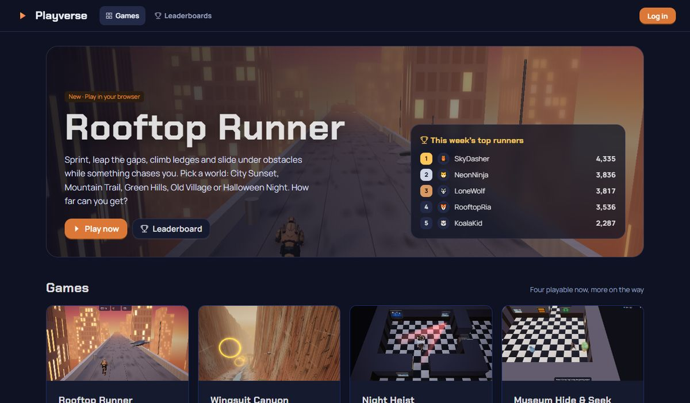

## The games

### Rooftop Runner: endless 3D runner

Sprint across rooftops, jump the gaps between buildings, climb ledges and slide under obstacles while something chases you. Pick one of five worlds and one of two characters.

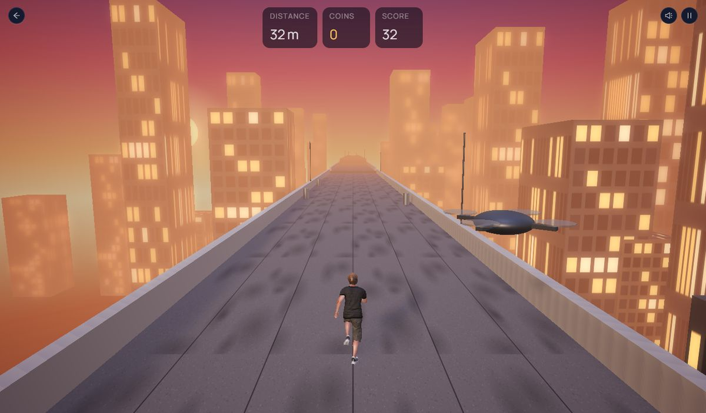

| World | Track | Obstacles | Chaser |
|---|---|---|---|
| City Sunset | Rooftops | AC units, pipes, water tanks | Drone |
| Mountain Trail | Cliff-top hiking path, pine valley, snowy peaks | Boulders, fallen logs, rock pillars | Eagle |
| Green Hills | Fenced meadow ridge, sheep and hay | Hay bales, fence rails, oak trees | Hawk |
| Old Village | Cobbled town wall above cottages | Crates, washing lines, wells | Crow |
| Halloween Night | Graveyard wall under a full moon | Jack-o'-lanterns, giant webs, crypts | Bat |

<p>
  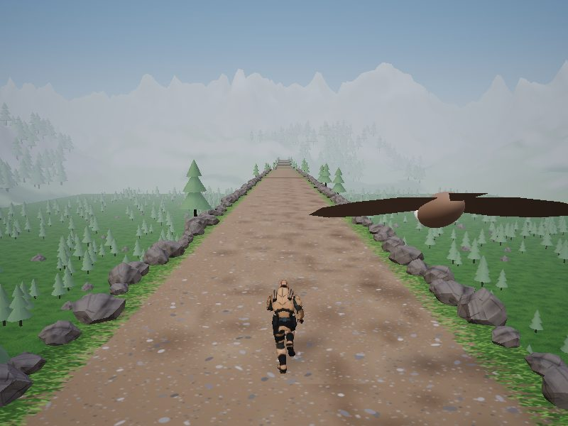
  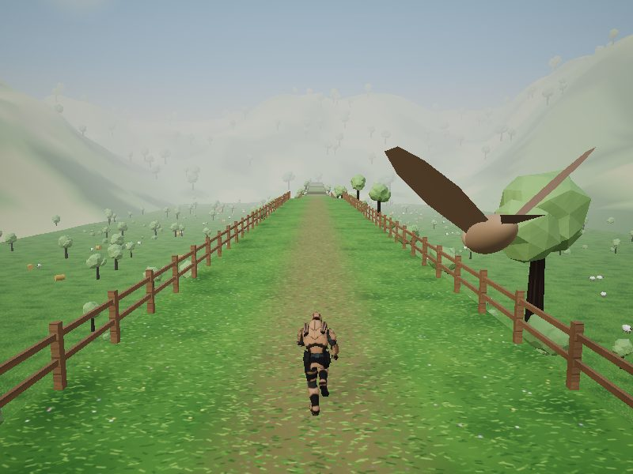
  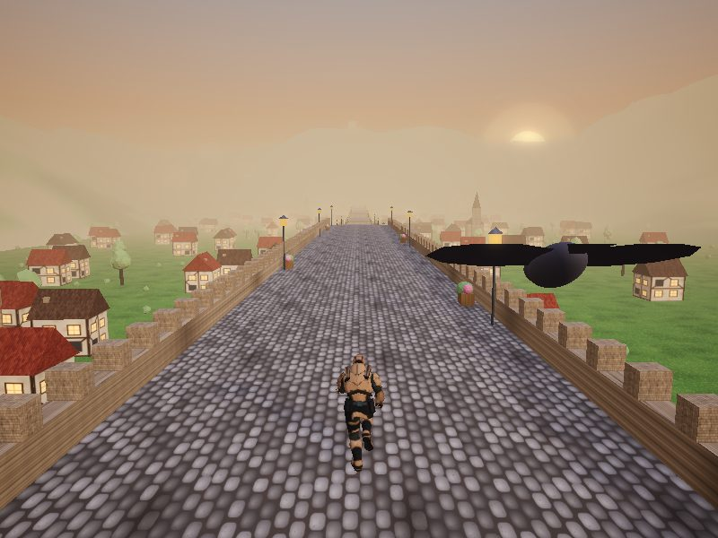
  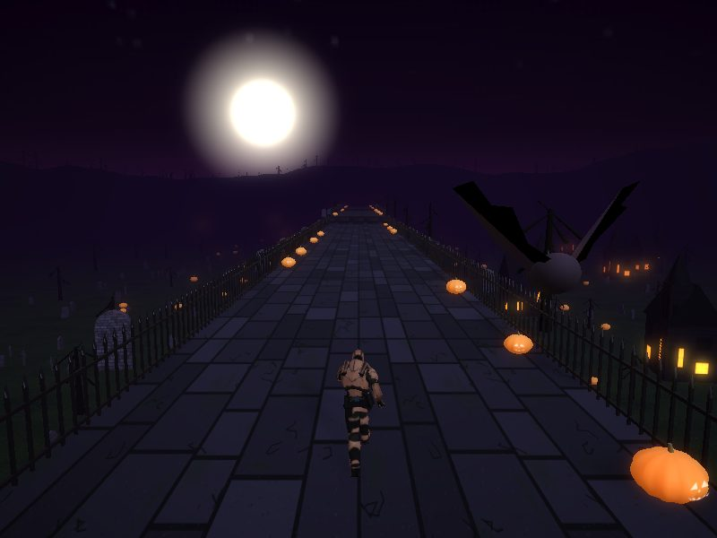
  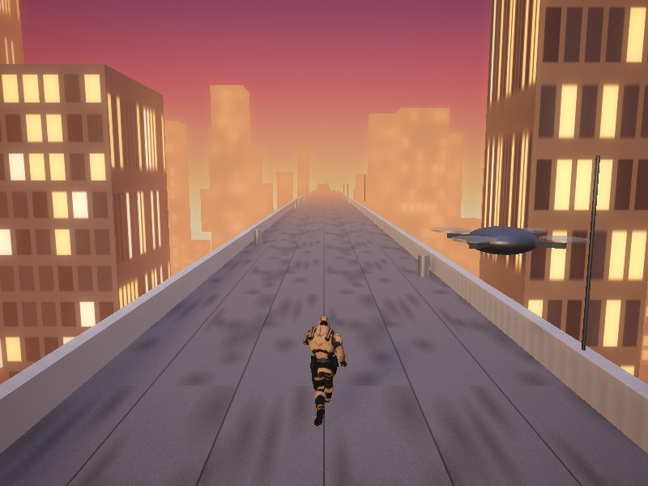
</p>

- Running jump, slide and ledge climb are real motion-captured animations that blend into each other.
- Every world uses the same collision sizes, so scores are fair across worlds.

<p>
  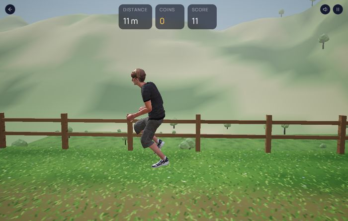
  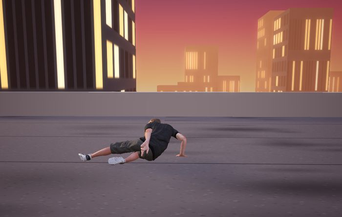
</p>

### Night Heist: 3D stealth

Sneak through a museum at night, steal the painting and escape. Three levels of increasing difficulty.

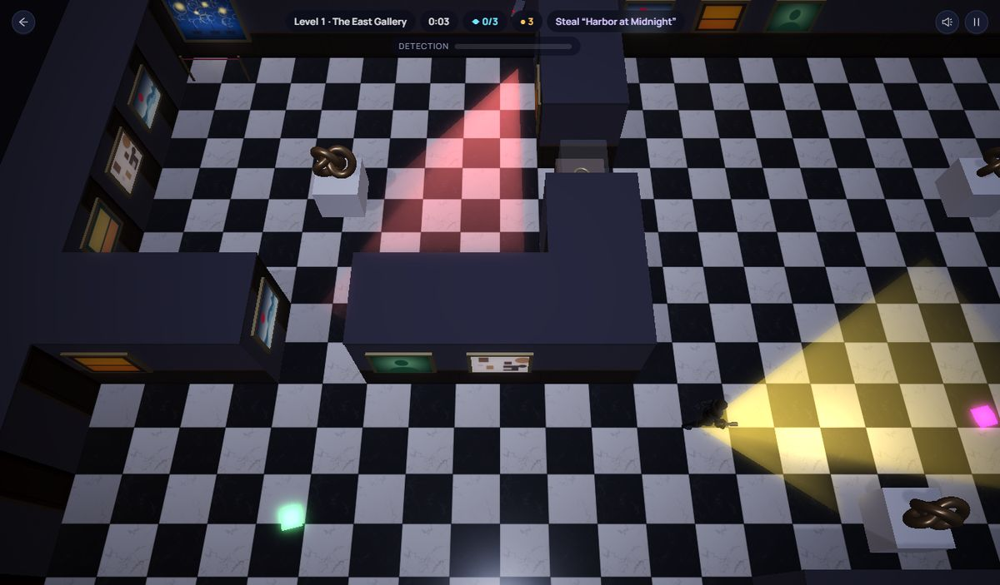

- **Guard AI:** guards follow patrol routes and see in a vision cone that walls block (ray casting on the level grid). What they notice fills a detection meter. They hear running and thrown coins, find a path to the noise with **A\* search**, look around, then return to their route.
- **Security systems:** sweeping cameras and timed laser grids.
- **Scoring:** points for escaping, gems, speed, and a "ghost" bonus if no one noticed you.
- Level maps are plain text grids, so new levels are easy to add.

### Wingsuit Canyon: 3D flying

Glide down a winding red-rock canyon. Diving trades height for speed; pulling up trades speed for height.

<p>
  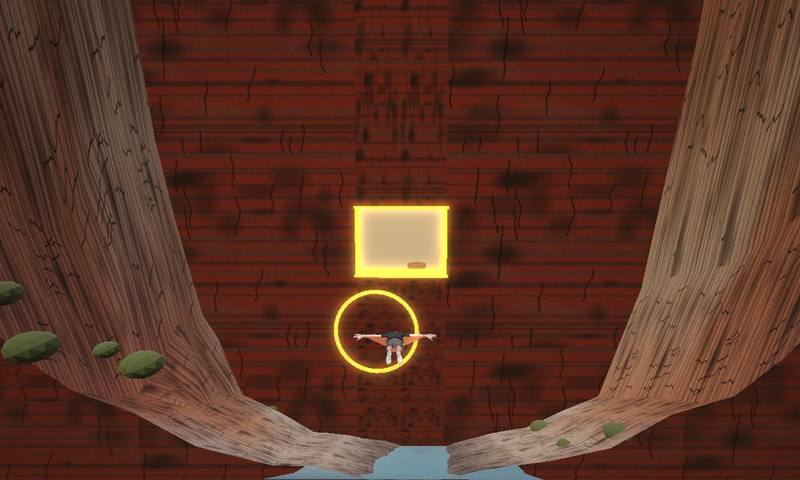
  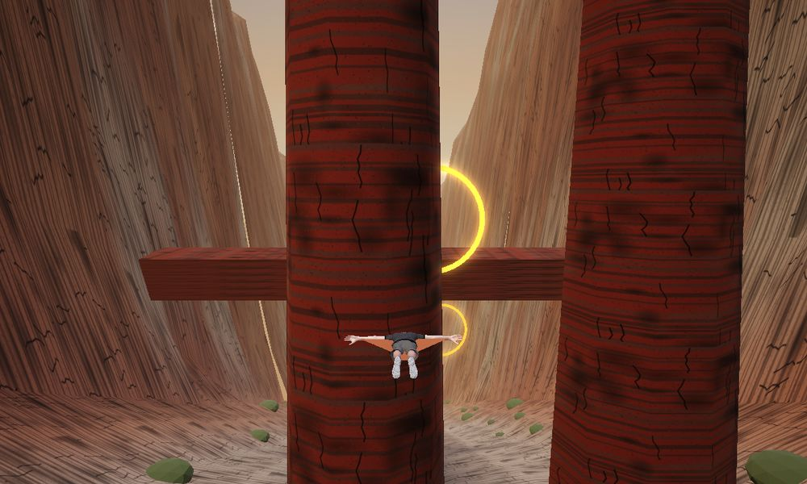
</p>

- **Hurdles:** rock gates with one window to fly through, stone bridges to go over or under, rock dams that force you to pull up, and rock towers. The canyon gets faster and narrower the further you fly.
- **Procedural canyon:** generated in 200 m chunks from noise, with ledged sandstone layers and a river. It's seeded, so every run flies the same canyon (fair scores).
- **Ghost race:** your best flight is saved and replayed as a glowing "Your best" marker to race against.

### Museum Hide & Seek: real-time online multiplayer

One player disguises as a museum object (a vase, a marble bust, a bench or a potted plant). The others have two minutes to find them. Play with friends using a 4-letter room code or an invite link.

<p>
  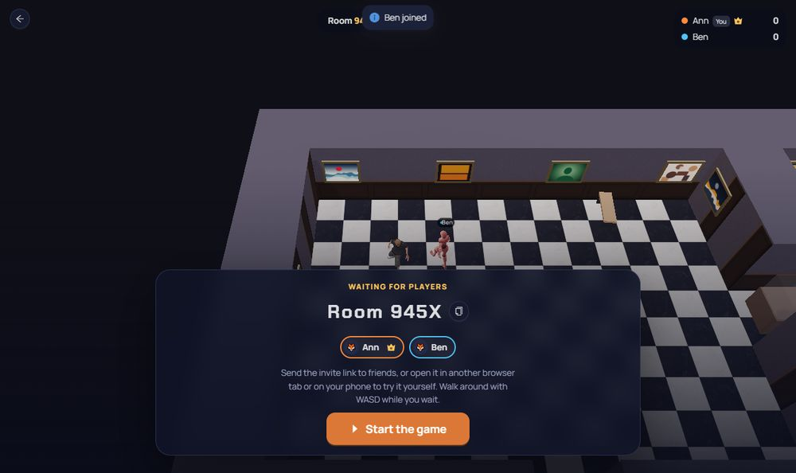
  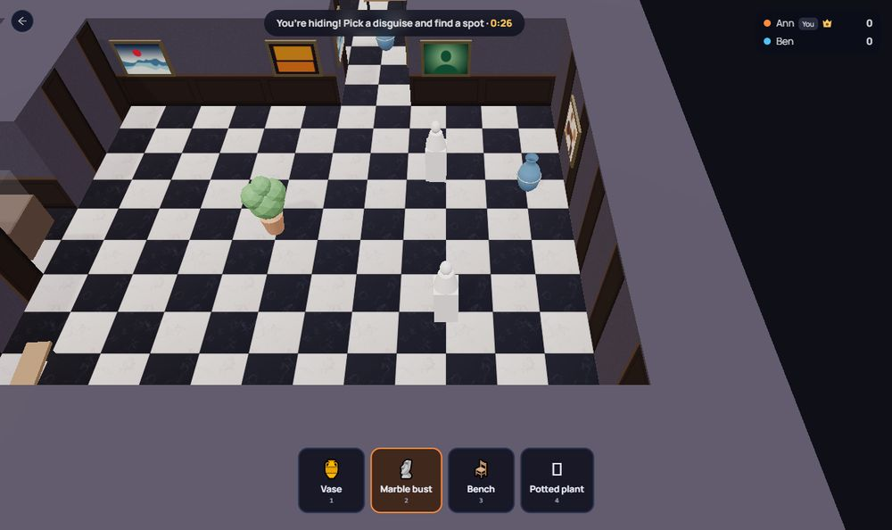
  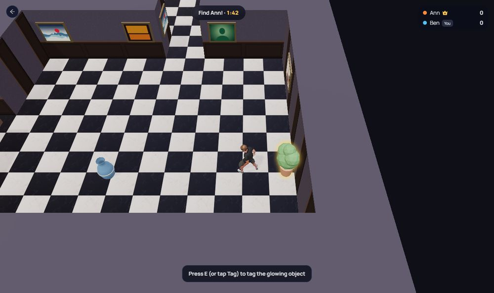
</p>

- **Rooms:** 2–8 players, host controls, invite links, and rejoining after a dropped connection.
- **Server-authoritative:** the server runs the round timer, picks who hides, places everyone, rejects moves faster than a player can run, and decides whether a tag found the hider. Clients only send their own movement and guesses, so nobody can cheat by editing the browser.
- **Smooth movement:** positions go out 15 times a second, and other players are drawn about 110 ms behind and blended between updates, so movement stays smooth on a shaky connection.
- Scores for logged-in players are saved by the server at the end of a match.

## On phones

Playverse is an installable app (PWA) and is packaged as an Android app (Trusted Web Activity), so it opens full-screen with its own icon.

<p>
  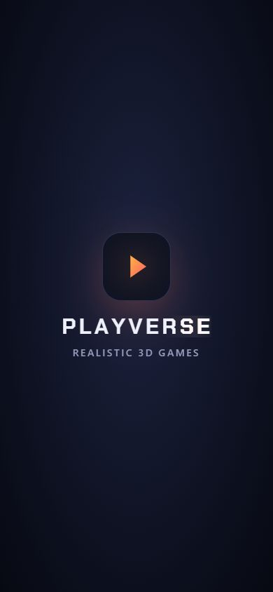
  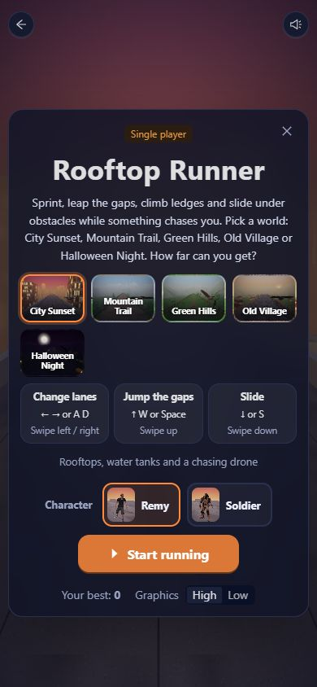
  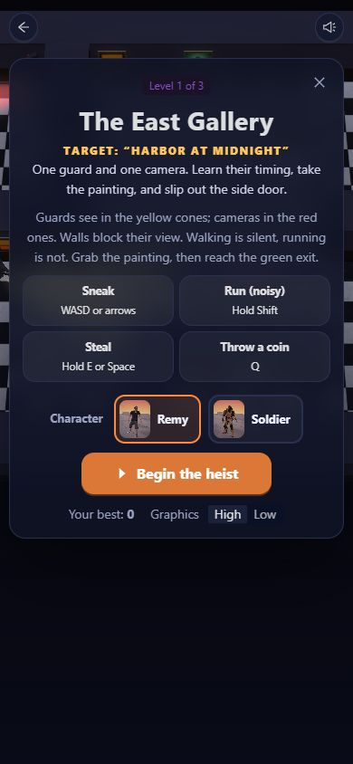
</p>

- Layouts adapt to small screens; every game has swipe or on-screen joystick controls.
- A service worker caches the game files, so the app opens fast after the first visit.

## Characters

<p>
  
  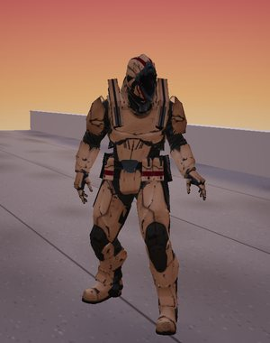
</p>

Choose **Remy** or the **Soldier** in every game. Each character has its own animations, and the moves the other one lacks are **retargeted** onto it at load time: for every frame, each bone's turn away from its T-pose is measured in model space, aligned between the two skeletons' body frames, and converted back into the target bone's local space. This works even though the two files use different bone axes and face opposite directions.

## Skills shown

**Frontend and UI/UX**
- React 19 with TypeScript (strict), React Router, React Query for server data
- Ant Design 6 with a custom dark theme; responsive layouts for desktop and phones
- UX details: opening animation, world and character pickers, loading progress, pause, results screens, keyboard, swipe and joystick controls, a "server waking up" notice, reduced-motion support and accessible labels

**3D graphics and game development (Babylon.js)**
- Physically based materials, image-based lighting, soft shadows, ACES tone mapping, glow
- Procedural content: canvas-painted textures, noise-based terrain, thin-instanced scenery, seeded levels
- Game logic: physics, collision detection, object pooling, chunk streaming
- AI: vision cones with ray casting, A\* path finding, patrol and investigate behaviour
- Animation: glTF characters, animation blending, skeleton retargeting, root-motion removal
- Asset pipeline: Mixamo FBX → glTF, textures compressed to WebP (20 MB → 2.6 MB)
- Game audio built from Web Audio oscillators and noise (no sound files)

**Backend**
- Node.js, Express 5 REST API with Zod validation, JWT authentication, bcrypt passwords, Helmet and rate limiting
- MongoDB with Mongoose: aggregations for per-player best scores and weekly/daily leaderboards
- Anti-cheat: scores that are impossible for the time played are rejected; multiplayer scores can only be saved by the server

**Real-time multiplayer**
- Socket.io rooms, a 15 Hz state tick, server-side movement validation, reconnect handling and client-side interpolation

**Testing, DevOps and deployment**
- Automated tests with node:test, an in-memory MongoDB and real socket clients
- Deployed on Render from a blueprint: a static website that never sleeps plus a Node game server, with MongoDB Atlas
- Progressive Web App (manifest, icons, service worker) and an Android app with verified Digital Asset Links

## Tech stack

| Part | Tools |
|---|---|
| Web app | React 19, TypeScript, Vite, Ant Design 6, React Query, React Router |
| 3D games | Babylon.js 9 (PBR, glTF characters, shadows, glow), Web Audio |
| API | Node.js, Express 5, Mongoose, Zod, JWT, bcrypt, Helmet, rate limiting |
| Real-time | Socket.io (rooms, server-authoritative game state) |
| Database | MongoDB Atlas (in-memory MongoDB for demo and tests) |
| Tests | node:test, supertest, socket.io-client |
| Hosting | Render (static site + web service), MongoDB Atlas |
| Mobile | PWA, Android app via Trusted Web Activity |

## Run it locally

You need Node.js 20 or newer.

**Quick demo (no database setup).** This starts the API with an in-memory database and sample players.

```bash
cd server
npm install
npm run demo          # API on http://localhost:4000
```

In a second terminal:

```bash
cd client
npm install
npm run dev           # open http://localhost:5174
```

Log in with **demo / demo12345**, or create your own account. For Hide & Seek, open a second browser tab and join with the room code.

**With a real database.** Copy `server/.env.example` to `server/.env`, fill in your MongoDB Atlas connection string and a JWT secret, then run `npm run dev` in `server` instead of `npm run demo`.

**Tests**

```bash
cd server
npm test
```

## API

All routes start with `/api`.

| Method | Route | What it does |
|---|---|---|
| POST | `/auth/register` | Create an account |
| POST | `/auth/login` | Log in with username or email |
| GET / PUT | `/auth/me` | Current player; change avatar |
| POST | `/scores` | Save a run (checked against game limits) |
| GET | `/leaderboard/:game?period=all\|week\|today` | Top 20 plus your rank |
| GET | `/me/stats` | Your totals, bests and recent runs |
| GET | `/games`, `/health` | Game list, health check |

Socket.io events (Hide & Seek): `join`, `start`, `move`, `tag`, `leave` from the client; `room`, `tick`, `event` from the server.

## Credits

The player characters are Remy from Adobe Mixamo and the Soldier sample model from the three.js examples (MIT license); the Hide & Seek players and Night Heist guards use the Xbot model from the same examples.
