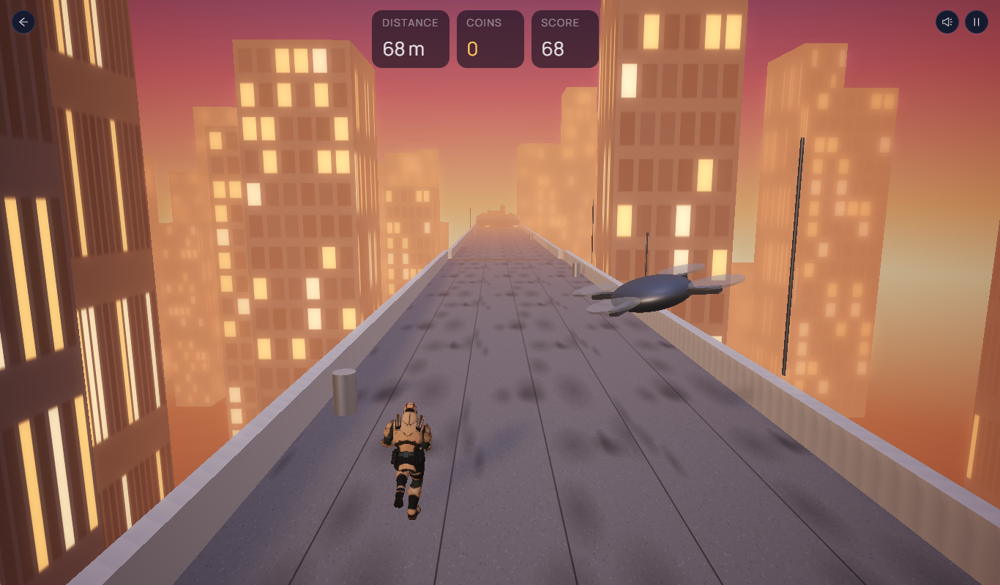

# Playverse

A game hub you play in the browser, with accounts, leaderboards and player profiles. Four 3D games are playable:

- **Rooftop Runner**, an endless runner: sprint, jump the gaps, climb ledges and slide under obstacles while something chases you, in one of five worlds.
- **Night Heist**, a stealth game: sneak through a museum at night, avoid guards, cameras and lasers, steal the painting and escape.
- **Wingsuit Canyon**, a flying game: glide down a winding red-rock canyon, through rings and under stone arches, and race a ghost of your best run.
- **Museum Hide & Seek**, online multiplayer: one player disguises as a museum object and the others hunt for them, in rooms you join with a 4-letter code.



## Features

- **Rooftop Runner (3D):** realistic lighting with image-based lighting, soft shadows, ACES tone mapping and glow. An animated character, procedural worlds, and High/Low graphics settings for slower devices.
- **Five worlds:** each has its own sky, lighting, track, obstacles, scenery and chaser.

  | World | Track | Obstacles | Chaser |
  |---|---|---|---|
  | City Sunset | Rooftops | AC units, pipes, water tanks | Drone |
  | Mountain Trail | Cliff-top hiking path, pine valley, snowy peaks | Boulders, fallen logs, rock pillars | Eagle |
  | Green Hills | Fenced meadow ridge, sheep and hay | Hay bales, fence rails, oak trees | Hawk |
  | Old Village | Cobbled town wall above cottages | Crates, washing lines, wells | Crow |
  | Halloween Night | Graveyard wall under a full moon | Jack-o'-lanterns, giant webs, crypts | Bat |

  All textures and landscapes are generated in code (canvas textures, noise-based terrain, instanced trees and houses), so the game ships no large art files. Every world uses the same collision sizes, so scores are fair across worlds.
- **Night Heist (3D stealth):** three levels of increasing difficulty.
  - Guards follow patrol routes and see in a cone that walls block (ray casting on the level grid). What they notice fills a detection meter. They hear running and thrown coins, find a path to the noise with A* search, look around, and return to their route.
  - Sweeping security cameras and timed laser grids.
  - Hold to cut the painting from its frame, collect gems, and reach the exit. Points for escaping, gems, speed, and a ghost bonus if no one noticed you.
  - Level maps are plain text grids, so new levels are easy to add.
- **Wingsuit Canyon (3D flying):**
  - Glide physics: diving trades height for speed and pulling up trades speed for height. The canyon floor drops at about the suit's glide angle.
  - The canyon is generated in 200 m chunks from noise, with ledged sandstone layers, a river, rock towers, arches and rings. It's seeded, so every run flies the same canyon (fair scores, and the ghost replays your exact line).
  - Points for distance, rings, close calls near the rock, and threading arches. Your best run is saved in the browser and replayed as a ghost.
- **Museum Hide & Seek (real-time multiplayer, Socket.io):**
  - Rooms with 4-letter codes and invite links, 2–8 players, host controls, and rejoining after a dropped connection.
  - The server is the referee: it runs the round timer, picks who hides, places everyone at the start of a round, rejects moves faster than a player can run, and decides whether a tag found the hider. Clients only send their own movement and guesses.
  - Positions go out 15 times a second; other players are drawn about 110 ms behind and blended between updates, so movement stays smooth on a shaky connection.
  - The museum and its decoy objects are generated from a seed the server shares, so every player sees the same rooms.
  - Scores for logged-in players are saved by the server at the end of a match. Clients can't post them.
- **Realistic player character:** Remy from Mixamo, converted from FBX to glTF and compressed from 20 MB to 2.6 MB (WebP textures). His run, walk and idle animations are retargeted at load time from another Mixamo rig, using model-space rotation deltas and a body-frame alignment, because the two files use different bone axes and facing. His running jump, slide and ledge climb are Mixamo moves made for Remy; their forward root motion is stripped at load (the game moves the world), and moves blend into each other.
- **Keyboard and touch controls:** arrow keys or WASD on desktop. On phones, swipes in Rooftop Runner and an on-screen joystick with buttons in Night Heist.
- **Accounts:** register and log in (JWT); pick an avatar.
- **Leaderboards:** each player's best score, all time, this week or today, with your own rank shown even outside the top 20.
- **Profile:** games played, time played, best score, recent runs with the world they were played in.
- **Server-side score checks:** the API rejects scores that are impossible for the run's length.
- **Coming soon:** Wingsuit Canyon, Night Heist, Ragdoll Arena, Museum Hide & Seek (online multiplayer).

## Tech stack

| Part | Tools |
|---|---|
| Web app | React 19, TypeScript, Vite, Ant Design 6, React Query, React Router |
| 3D game | Babylon.js 9 (PBR materials, glTF characters, shadows, glow), Web Audio |
| API | Node.js, Express 5, Mongoose, Zod validation, JWT, bcrypt, Helmet, rate limiting |
| Database | MongoDB (Atlas in production, in-memory for demo and tests) |
| Real-time | Socket.io (rooms, server-authoritative game state) |
| Tests | node:test with an in-memory MongoDB; multiplayer tests drive real socket clients |

## Run it locally

You need Node.js 20 or newer.

**Quick demo (no database setup).** This starts the API with an in-memory database and sample players.

```bash
cd server
npm install
npm run demo          # API on http://localhost:4000
```

In a second terminal:

```bash
cd client
npm install
npm run dev           # open http://localhost:5174
```

Log in with **demo / demo12345**, or create your own account.

**With a real database.** Copy `server/.env.example` to `server/.env`, fill in your MongoDB Atlas connection string and a JWT secret, then run `npm run dev` in `server` instead of `npm run demo`.

**Tests**

```bash
cd server
npm test
```

## Production build

```bash
cd client && npm run build      # writes client/dist
cd ../server && npm start       # serves the API and client/dist on one port
```

## API

All routes start with `/api`.

| Method | Route | What it does |
|---|---|---|
| POST | `/auth/register` | Create an account |
| POST | `/auth/login` | Log in with username or email |
| GET / PUT | `/auth/me` | Current player; change avatar |
| POST | `/scores` | Save a run (checked against game limits) |
| GET | `/leaderboard/:game?period=all\|week\|today` | Top 20 plus your rank |
| GET | `/me/stats` | Your totals, bests and recent runs |
| GET | `/games`, `/health` | Game list, health check |

## Credits

The player character is Remy from Adobe Mixamo. Animations come from the Soldier sample model in the three.js examples (MIT license), and the Night Heist guards use the Xbot sample model from the same examples.
